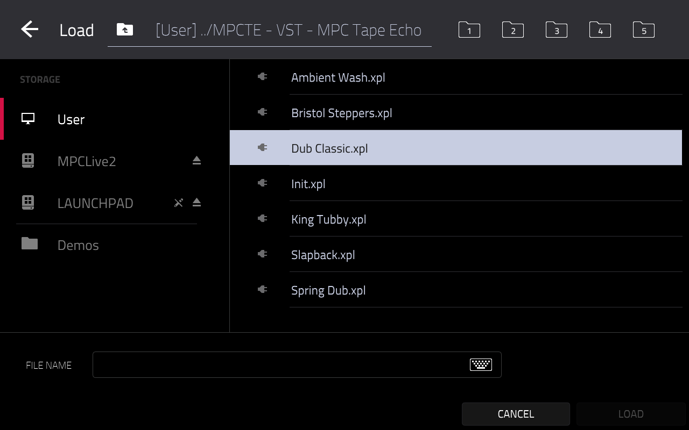
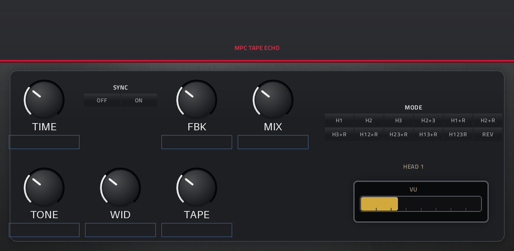
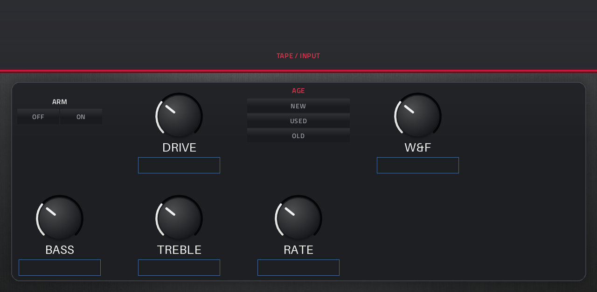
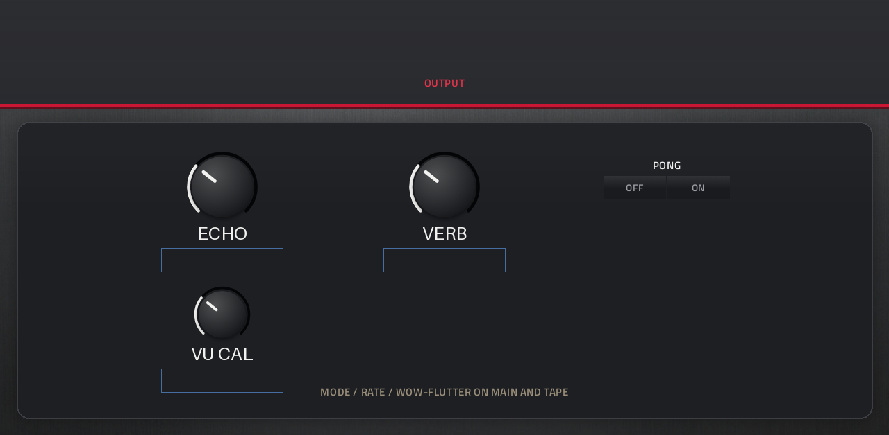

# MPC Tape Echo

A three-head tape echo with a spring tank for Akai MPC and Force standalone devices: 12 head and
reverb modes, tape saturation, wow and flutter, tape age, tempo sync, and a VU meter that moves like
the hardware's.



## Why this exists

A tape echo is a playing instrument, not a preset. You ride the rate, push the feedback until the
repeats start to fold, and let the spring sit behind it. MPC OS has a VST2 host but nothing in it that
does that.

This is the **Tape Echo 2** DSP core by Dusk Audio, vendored at v1.4.5 through the Schwung project
(`athousanddetails/schwung-tape-echo2`, commit `10671072`), wrapped as a native MPC plugin: same DSP,
an MPC screen with three tabs and a 12-mode grid, and 21 parameters on the Q-Links.

## What it does

| | |
| --- | --- |
| Modes | H1, H2, H3, H2+3, H1+R, H2+R, H3+R, H12+R, H23+R, H13+R, H123R, Rev |
| Echo | Rate, Feedback, Echo level, tempo sync |
| Tape | age, wear, wow and flutter, tone tilt |
| Spring | level, in the same modes as the heads |
| Output | mix, ping-pong, live VU |
| Parameters | 21 |

| Page | |
| --- | --- |
| Echo |  |
| Tape |  |
| Spring |  |

## Status

**v1.0.0**, built for armv7 and installed on an MPC Live II running MPC OS 3.9.1.2. The binary in this
release is the one that was measured below (md5 `066d98459ee1d3971a0068c3d65d6489`).

Not done yet: a walkthrough of every control position on the device, and a check on firmware 3.10.
Both are milestone 1 and 3 in [ROADMAP.md](ROADMAP.md).

## CPU

Measured on the device with the framework's bench (`tools/bench.sh`, 128 frames at 44.1 kHz = 2902 µs
per block), on the same binary this repository ships:

| Stage | mean | p99 | worst block |
| --- | --- | --- | --- |
| idle | 16.9 % | 17.6 % | 20.0 % |
| audio in | 17.2 % | 18.0 % | 18.3 % |
| Q-Link sweep | 18.2 % | 19.8 % | 20.2 % |
| release tail | 18.7 % | 19.5 % | 20.0 % |

**Verdict: WARN** (framework scale: PASS ≤ 15 %, WARN ≤ 35 %). That means one or two instances in a
project, not a whole rack.

Where the time goes, from a gprof profile of the same core:

- **The spring tank is ~60 % of the total.** It is 3 waveguides × 24 dispersion biquads × 2 directions,
  which is 144 biquad sections per sample. The 24 sections are fitted to the physical spring, not a
  tuning knob.
- The 4× oversampled preamp is ~5 %.
- The rest is the modelled tape path.

Compiler flags (`-O3 -ffast-math -mfpu=neon-vfpv4 -ftree-vectorize`) already took it from 23.9 % to
20.3 %, and interleaving the spring dispersion is bit-identical. Bypassing the oversampler entirely
buys 0.8 pp; running a single spring instead of three buys 1.5 pp and changes the tank. **PASS is not
reachable without changing how the reverb sounds**, so this ships as WARN with the numbers above rather
than with a quieter, different spring.

## Install

Download the zip from [Releases](https://github.com/mitchoster/mpc-vst-tape-echo/releases), unpack it on
the device and run `install.sh` as root. The installer stops MPC, backs up `MPC.settings`, copies the
plugin folder and restarts MPC.

## Build

Requirements: Docker, plus a checkout of the porting framework
[`sd88me/mpc-vst-plugins`](https://github.com/sd88me/mpc-vst-plugins) (MIT).

```bash
git clone https://github.com/sd88me/mpc-vst-plugins
export MPC_VST_PLUGINS="$PWD/mpc-vst-plugins"

vst/test.sh          # offline host test, must print PASSED
vst/build.sh         # cross-compiles for armv7 -> vst/build/mpc_tape_echo.so + skin
vst/tests/run.sh     # DSP tests, including the render comparison against the pristine core
```

The build container is `arm32v7/gcc:11-bullseye` (MPC OS links against glibc 2.32). Deployment and
registration are described in the framework's `docs/PORTING.md`; both need root SSH on the device.

## License

**GPL-3.0-only.** The DSP core is the work of Dusk Audio, vendored through
`athousanddetails/schwung-tape-echo2` at v1.4.5. Copyright and license notices are retained; the exact
commit, file list and the one local optimisation are recorded in `vst/src/VENDORED.md`.

The porting framework is MIT and is a build dependency, not vendored here.

Not affiliated with Akai Professional, inMusic or Roland. Product names are used only to say what this
plugin runs on and what it sounds like. The panel artwork contains no manufacturer logos or trade dress.
